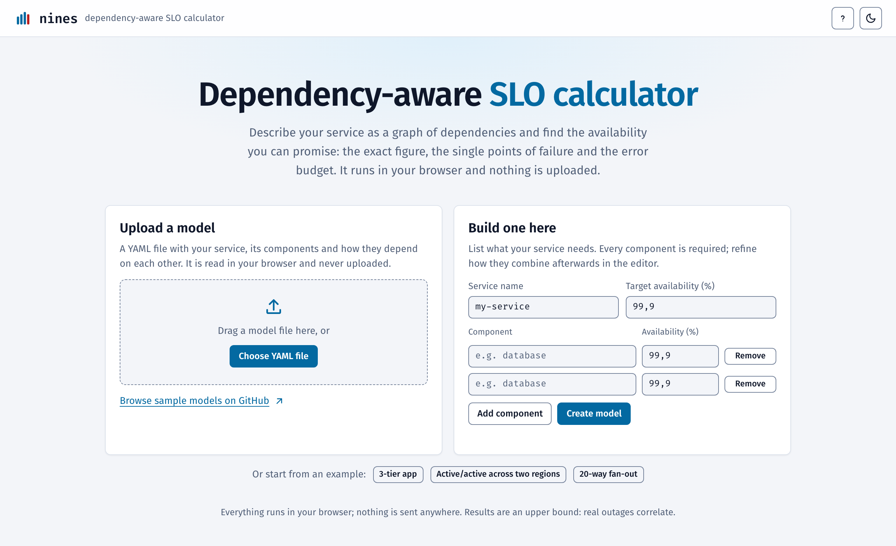

# nines

A dependency-aware SLO calculator. Describe a service as a graph of components and dependencies, give each an
availability, and `nines` tells you:

- the availability you can actually promise, **exactly**, even when the same component sits on several paths;
- the **dependency ceiling**: the best you could do if everything you own were perfect;
- single points of failure, and which component to improve for the biggest gain;
- whether 99.95% is even possible, optionally with uncertainty;
- a step-by-step derivation that a product or management audience can follow.

It is a Go library and CLI, with the same core compiled to WebAssembly for a static web app (`web/`, nothing leaves
the browser).



## Why not just multiply percentages?

Multiplying down the tree double-counts any component that appears in more than one place. `nines` compiles the model
into a boolean function over independent components and evaluates it exactly with a binary decision diagram (BDD).

**Twenty dependencies in series.** Twenty 99.9% dependencies, all required, give about 98.02%, not 99.9%:

```console
$ nines check testdata/models/fanout.yaml
fan-out

  Target             99.90%  (43.2 min downtime / 30d)
  Computed           98.02%  (856 min downtime / 30d)
  Dependency ceiling not computed: no component is marked owned: true
  Verdict            INFEASIBLE
  Tier               below 99%

Biggest levers (gain if made perfect):
  1. dep-01               99.90%  +0.0981 pp  (42.4 min less downtime / 30d)
  2. dep-02               99.90%  +0.0981 pp  (42.4 min less downtime / 30d)
  3. dep-03               99.90%  +0.0981 pp  (42.4 min less downtime / 30d)
  4. dep-04               99.90%  +0.0981 pp  (42.4 min less downtime / 30d)
  5. dep-05               99.90%  +0.0981 pp  (42.4 min less downtime / 30d)

Single points of failure: dep-01, dep-02, dep-03, dep-04, dep-05, dep-06, dep-07, dep-08, dep-09, dep-10 and 10 more

99.90% is not met (98.02% computed). The biggest lever is dep-01. Improve it, add redundancy, or promise a target below 99%.
```

**A shared dependency.** Two redundant paths that both need the same database are not independent. Naive
multiplication treats the database as two components and is optimistic:

```console
$ nines check testdata/models/shared.yaml
shared-db

  Target             99.00%  (432 min downtime / 30d)
  Computed           98.01%  (860 min downtime / 30d)
                     what naive multiplication would say: 98.81%
  Dependency ceiling 99.00%  (432 min downtime / 30d, if everything you own were perfect)
  Verdict            INFEASIBLE
  Tier               below 99%

Biggest levers (gain if made perfect):
  1. a                    90.00%  +0.9900 pp  (428 min less downtime / 30d)
  2. b                    90.00%  +0.9900 pp  (428 min less downtime / 30d)
  3. db                   99.00%  +0.9900 pp  (428 min less downtime / 30d)

Single points of failure: db
Pairs that take it down together: a + b

99.00% is not met (98.01% computed). The biggest lever is a. Improve it, add redundancy, or promise a target below 99%.
```

`nines explain` shows why, in plain words, with exact values instead of products wherever children share a component:

```console
$ nines explain testdata/models/shared.yaml
shared-db works 98.01% of the time because:

- ALL of these must work: 98.01%
  - AT LEAST ONE of these must work: 98.01%
    (shared components: db. The parts below are not independent, so this is the exact value, not a product of them.)
    - ALL of these must work: 89.10%
      - a works: 90.00%
      - db works: 99.00%
    - ALL of these must work: 89.10%
      - b works: 90.00%
      - db works: 99.00%
```

**Is 99.95% possible?** A realistic model with a vendor SLA entered as an interval and a measured dependency entered as
counts. With `--uncertainty`, component availabilities are sampled and the same BDD is re-evaluated 10,000 times:

```console
$ nines check testdata/models/realistic.yaml --uncertainty
orders-api

  Target             99.95%  (21.6 min downtime / 30d)
  Computed           99.905%  (41.0 min downtime / 30d)
  Dependency ceiling 99.915%  (36.7 min downtime / 30d, if everything you own were perfect)
  Verdict            INFEASIBLE
  Uncertainty        mean 99.9047%, p5 99.863%, p50 99.9042%, p95 99.9465%  (10000 samples, seed 1)
  P(meets target)    2.6%
  Tier               99.50%

Biggest levers (gain if made perfect):
  1. gateway              99.945%  +0.0550 pp  (23.8 min less downtime / 30d)
  2. payments             99.90%  +0.0200 pp  (8.6 min less downtime / 30d)
  3. auth                 99.99%  +0.0100 pp  (4.3 min less downtime / 30d)
  4. self                 99.99%  +0.0100 pp  (4.3 min less downtime / 30d)
  5. db-primary           99.95%  +0.0000 pp  (0.01 min less downtime / 30d)

Single points of failure: payments, gateway, self, auth
Pairs that take it down together: db-primary + db-replica; az-a + db-replica; db-primary + az-b; az-a + az-b
warning: payments is a single point of failure at 99.90%, below the 99.95% target
warning: gateway is a single point of failure at 99.945%, below the 99.95% target

99.95% is not possible: even if everything you own were perfect, dependencies cap you at 99.915%. Add redundancy to the dependencies or promise the 99.50% tier.
```

Even a perfect service cannot reach 99.95% here, because the gateway and the payments vendor cap it. What would fix it?

```console
$ nines whatif testdata/models/realistic.yaml --set gateway=99.99 --set payments=99.99
change: set gateway to 99.99% (was 99.945%)
change: set payments to 99.99% (was 99.9%)

             before       after        change         downtime change / 30d
  computed   99.905%      99.968%      +0.0630 pp     -27.2 min
  ceiling    99.915%      99.978%      +0.0630 pp     -27.2 min
  verdict    infeasible   achievable
```

```console
$ nines solve testdata/models/realistic.yaml --component gateway
gateway must be at least 99.99002704% (now 99.945%) for the system to meet 99.95%.
```

## Install

```bash
go install github.com/marcelblanarik/nines/cmd/nines@latest
```

or download a binary from the releases page (linux/amd64, linux/arm64, darwin/arm64, windows/amd64).

## Commands

```
nines check   model.yaml [--format table|json|md] [--uncertainty] [--seed N] [--no-fail]
nines explain model.yaml                       # derivation trace
nines whatif  model.yaml --set payments=99.99 --remove db-replica
nines solve   model.yaml --component auth
nines graph   model.yaml                       # Mermaid, annotated with availabilities
nines fmt     model.yaml                       # validate and normalize (drops comments)
nines version
```

Exit codes: `0` achievable or marginal, `1` runtime error, `2` invalid model (errors carry `file:line`), `3`
infeasible. Pass `--no-fail` to `check` to always exit 0, or gate CI on the default.

## Model file

```yaml
service: checkout
target: 99.95          # percent
window: 30d            # used for the downtime-minutes display

components:
  self:       {availability: 99.98, owned: true}
  auth:       {availability: 99.95, source: measured}
  payments:   {availability: 99.90, source: vendor-sla, transient_fraction: 0.8}
  db-primary: {availability: 99.95, group: az-a}
  db-replica: {availability: 99.95, group: az-b}
  az-a:       {availability: 99.99}
  az-b:       {availability: 99.99}

requires:
  all:
    - self
    - auth
    - retry: {of: payments, attempts: 3}
    - any: [db-primary, db-replica]
```

Availability is a percentage (`99.95` or `"99.95%"`, within (50, 100]; a value like `0.9995` is rejected with a hint),
an uncertain interval `{interval: [99.8, 99.95]}`, or measured counts `{counts: {good: 999500, total: 1000000}}`
(uncertainty model: Beta(good + 1, bad + 1)). `owned: true` marks components your team controls; the dependency
ceiling is the availability with all of them perfect.

| Operator | Meaning |
|---|---|
| `all: [...]` | every member must work |
| `any: [...]` | at least one must work (active redundancy) |
| `k_of_n: {k, of: [...]}` | at least `k` of the members must work |
| `retry: {of: component, attempts: n}` | up to `n` attempts; helps only against the share of failures that is transient |
| `fallback: {primary, fallback, coverage}` | the primary, or the fallback when it can serve the request (`coverage` is that share) |
| `cached: {of, hit_ratio}` | served from cache, or the origin works |
| `optional: {of, touch}` | only a fraction `touch` of requests need it |
| component `group: G` | the component also needs the shared group component `G` (an AZ, region, vendor control plane) |

`transient_fraction` is the share of a component's failures that a retry can fix. Each call site of a component gets
its own fresh transient failures, so calling the same dependency twice in one request path exposes the request to its
transient failures twice. Persistent failures are shared by every reference.

## Web app

`web/` is a static single-page app: a YAML editor, an interactive graph (Cytoscape with the dagre layout), a slider
per component that recomputes live from the same Go core compiled to WebAssembly, and the step-by-step derivation.
The whole model, plus any slider changes, lives in the URL fragment (deflate, then base64url), so a shared link
reproduces the exact model and result. There is no backend and, after the initial load, no network requests.

The page opens with a title and two ways in: upload a model file (choose it or drag it in; files over 512 KB are
refused and invalid ones list their errors), or list your components in a form to get a service that needs all of
them. Three example buttons below them load a ready-made model. Nothing else is shown until there is a model; then the
result appears underneath and the page scrolls to it. A shared link opens straight on its result.

The result is the answer (availability, verdict, error budget) above the dependency graph, then the numbers, then a
Components box (what-if sliders, Edit, Remove and an "Add a component" row) next to the model text, and last the
findings and the derivation. The header repeats the availability and verdict so they stay in view while you drag a
slider further down. Selecting a node (or pressing Edit) slides in an editor that Esc closes; on a narrow screen it is
a sheet from the bottom.

Keyboard: `?` lists the shortcuts, `f` fits the graph, `+` and `-` zoom, `u` toggles the uncertainty run, `t` switches
light and dark, `n` jumps back to the upload and form, and Esc closes the editor. They are ignored while you type in a
field.

You can shape the model without writing YAML:

- **What-ifs:** drag a component's slider, or press Remove to see what the model looks like without it. Neither
  touches the model text, and both are saved in the share link.
- **Uncertainty:** the switch above the result samples interval and counts inputs and shows the spread and the chance of
  meeting the target.
- **Add a component:** a form adds it and says how the service uses it (required, a redundant alternative to another
  component, or not used yet).
- **Edit selected:** click a node in the graph, or press Edit on a slider row. For a component you can change how its
  availability is known (percentage, range or counts), owner, transient fraction and group, or delete it. For an
  operator you can switch all/any, change k, retry attempts or a ratio, and add members.

These edits rewrite the model text in canonical form, so comments in it are dropped. The text editor stays the
source of truth: change it directly at any time.

```bash
make web                       # builds web/public/nines.wasm, then web/dist
cd web && npx vite preview     # serve it locally
```

Examples: a 3-tier app, active/active across two regions, and the 20-way fan-out. The page has dark and light themes
(it follows the system setting; the header button overrides it).

## Limitations

Read these before quoting a number.

- **Results are an upper bound, not a forecast.** Components are independent unless you group them. Real outages
  correlate: shared control planes, bad config pushes. Use `group` to model what you know.
- **Availability is an average over requests.** It says nothing about how outages cluster in time. A system at exactly
  99.95% on average will breach a 30-day 99.95% target in a large share of windows. This is why the tool rounds the
  recommended tier down and wants headroom.
- **No latency composition and no load-dependent failures** (retry storms, queue saturation, cascades).
- **Vendor SLAs are a contract, not an observed availability.** Enter them as an interval with a pessimistic lower end.

## How it works

Every component is one or more independent Bernoulli variables. The `requires` tree is compiled to a boolean formula
over them, turned into a reduced ordered BDD, and `P(system works)` is computed by Shannon expansion over the BDD.
The same BDD gives restriction (ceiling, importance, `solve`) and minimal cut sets (single points of failure). If
the BDD outgrows `--max-bdd-nodes` the tool falls back to Monte Carlo and says so. See `DECISIONS.md` for every place
the implementation chose or deviated from the original plan.

## Development

```bash
make test      # go vet + go test -race (includes the brute-force oracle and golden files)
make golden    # regenerate testdata/golden after an intended output change
make fuzz      # fuzz the model validator
make web       # build the WASM core and the static web app
```

The README examples above are executed by `cmd/nines/readme_test.go`, so they stay true.

## License

MIT, see `LICENSE`.
